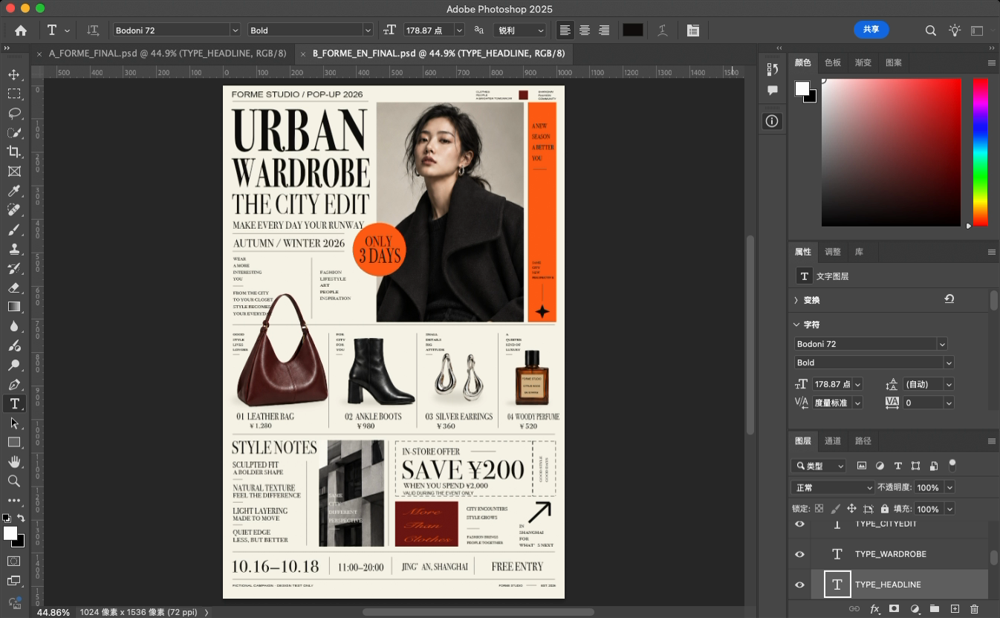
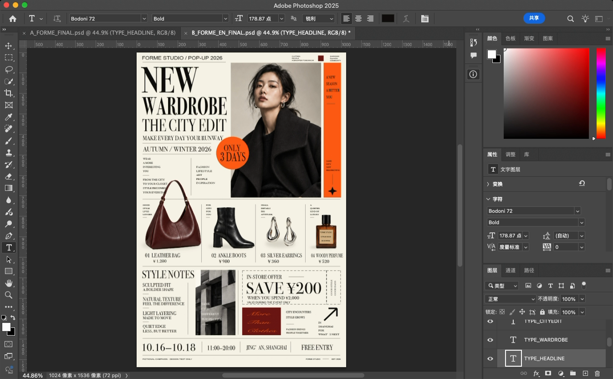
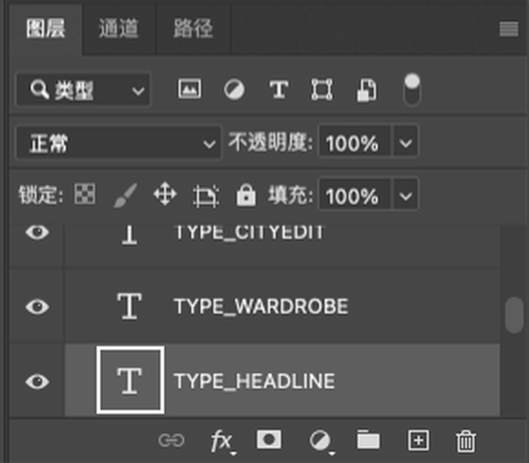
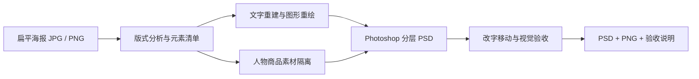

# niaoshu海报拆解skill

让 Agent 分析扁平海报，并在本机 Adobe Photoshop 中重建可继续编辑的分层 PSD。

由 niaoshu（谭老师）为设计工作制作。当前版本 **2.0.0**，包含 30 种风格测试后整理的流程修复与验收规则。

> 这是供 Agent 使用的工作流、脚本和检查规范，不是独立运行的一键转换软件。结果是基于原图的分层重建，不是恢复原始设计工程。

## 先看一个真实例子

你已经用 AI 做出一张满意的海报，只想改标题、日期或价格，却不想为一个小改动重新生成整张画面。这个 Skill 的用途，是先把图片**重建成能继续修改的设计文件**，后续再在对应图层上调整。

下面是本项目历史 Photoshop 操作录屏中的真实截图：同一张重建后的 PSD，将标题 **URBAN → NEW**。人物、商品和底部日期的位置保持；右侧可以看到选中的 `TYPE_HEADLINE` 文字层。

| 改字前：URBAN | 改字后：NEW |
| :---: | :---: |
| [](docs/images/photoshop-title-before.png) | [](docs/images/photoshop-title-after.png) |

**图层面板特写：** 标题是带 `T` 图标的文字层，可以继续编辑文字内容。



点击前后截图可查看完整大图。截图来自历史录屏，不是模型生成的界面；本次没有重新运行 Photoshop。这组演示仅证明标题修改，日期修改、商品替换等下述场景仍需针对输入图执行和验收。详见 [图片来源与说明](docs/IMAGE_SOURCES.md)。

## 用来解决哪些工作问题

| 使用场景 | 常见需求 | 重建后可以怎样继续工作 | 需要注意 |
| --- | --- | --- | --- |
| 电商品牌 / 产品运营 | 更换促销标题、价格、规格和活动期限 | 在对应文字层改信息，调整独立标签和促销色块 | 商品上的包装字、反光和遮挡不能简单当普通文字处理 |
| 品牌发布会 / 展览活动 | 改日期、地点、嘉宾或报名信息 | 保留已认可的主视觉，在分层文件中更新活动文案 | 长文案要重新检查宽度、换行和留白 |
| 珠宝 / 美妆新品 | 换系列标题、卖点或副标题 | 调整文字层；有干净新素材时替换商品对象 | 替换商品后需重新检查比例、光影、边缘和原背景残影 |
| 精品酒店 / 餐饮门店 | 更新套餐、节庆活动和预订信息 | 复用已有排版，修改价格、日期、CTA 或装饰组件 | 字体替代、复杂底纹可能需要人工精修 |
| 没有独立设计部门的小团队 | 只有一张 JPG/PNG，却要反复更新宣传图 | 让具备 Photoshop 操作能力的 Agent 完成重复建层和检查，再交给负责人核对 | 仍需要 Photoshop、可用 Agent 与最终人工验收 |
| 设计师 / 外包团队 | 客户只交扁平稿，希望得到可修改文件 | 以原图为参考，重建文字、图形和素材结构，减少重复操作 | 不等于恢复客户原来的字体、蒙版或工程结构 |

这些是适用的工作方向，不是每张输入图都能自动成功的承诺。最有价值的情况通常是：**版式已确定，而且之后还要多次更新内容**。

## “可编辑”具体指什么

| 元素 | 目标图层形式 | 可以怎样编辑 | 边界 |
| --- | --- | --- | --- |
| 标题、日期、价格、正文 | Photoshop 实时文字层 | 改字、改大小、颜色、位置和排版 | OCR 要逐字核对；缺失字体可能需替代 |
| 色块、线条、圆形、卡片 | 独立形状层或独立像素层 | 分别移动、隐藏、调色 | 像素层不等于可编辑矢量路径 |
| 人物、商品、照片、复杂纹理 | 隔离图层 / 嵌入智能对象 | 移动、缩放、隐藏，或替换素材 | 内部不自动矢量化；素材隔离和背景补全需验收 |
| 背景与遮挡区域 | 独立背景与补全素材 | 与文字、主体分开处理 | 原图中看不见的内容只能补全或近似重建 |
| 阴影、装饰、复杂字效 | 可行时分层重绘或隔离 | 对已独立的部分继续调整 | 金属字、书法、透视字等可能需要额外制作 |

**第一次重建仍可能消耗模型 Token 和操作时间。** 重建通过后，小幅改字可以直接在 Photoshop 图层里完成，或继续交给 Agent 修改；后者仍会产生相应调用消耗。因此它旨在减少反复整图生成，不承诺“零 Token”。

## 谁适合用、什么时候暂不适合

- **适合：** 接受先重建、再验收的设计师与运营人员；需要多次更新同一套视觉的小团队；希望获得 PSD 继续精修的人。
- **更容易开始：** 清晰文字、规则网格、常规中英排版、简单几何、主体边缘清楚的海报。
- **需要更多人工：** 极小文字、模糊压缩图、金属立体字、书法、复杂蒙版、透视变形、主体与背景高度融合的画面。
- **不适合作为保证：** 像素级恢复丢失工程、找回不可见背景、自动识别所有原字体、把照片中的每个元素变成独立矢量。

## 使用条件

1. 本机已安装并可正常运行 Adobe Photoshop，支持执行 JSX / ExtendScript。
2. Agent 支持加载本地 Skill、读取图片和准备脚本，并拥有操作本机 Photoshop 的工具及所需权限。仅支持文字对话的 Agent 无法完成整个流程。
3. 字体已安装；缺失字体必须说明替代方案。
4. 输出盘和 Photoshop 暂存盘空间充足。
5. 可选工具：Python 3 用于预检；macOS Swift / Vision 用于 OCR 草稿；FFmpeg 用于纯色背景素材提取。Swift OCR 入口仅适用于 macOS。

此 Skill 不附带 Photoshop、模型 API 或电脑控制工具。模型调用、软件与素材使用条件由使用者自行配置。

## 安装

**[下载 v2.0.0 安装包](https://github.com/tanfeizao/poster-full-element-editable-psd/releases/tag/v2.0.0)**，或使用下面的源码安装方法。安装版功能与当前介绍一致；本次图文文档补充位于仓库首页。

在 GitHub 点击 **Code → Download ZIP** 并解压，将包含 `SKILL.md`、`scripts/`、`references/`、`agents/` 的完整文件夹命名为 `poster-full-element-editable-psd`，放进你所用 Agent 的 Skill 目录，再按该 Agent 的方式刷新或重新打开会话。

也可以直接让你的 Agent 帮你安装本仓库：

```text
请将 https://github.com/tanfeizao/poster-full-element-editable-psd
作为本地 Skill 安装，保留 scripts、references 和 agents 子目录。
安装后先检查是否具备操作本机 Photoshop 的能力，再开始处理海报。
```

目录位置因 Agent 而异；如果已有同名 Skill，先备份并比较版本，不要直接覆盖。

## 开始使用

把海报图片交给 Agent，然后说明：

```text
使用海报拆解 Skill，把这张海报重建成可以继续编辑的 PSD。
文字需要是实时文字层；图形、人物和商品分别分层。
保留原始图片和已有文件，输出到我指定的新文件夹。
请先列出元素清单，再操作 Photoshop。
完成后重新打开 PSD，测试修改标题和日期、移动主体，并检查旧字和残影。
同时交付 PSD、PNG 预览、验收结果，以及字体替代和近似重建说明。
```

Skill 内部标识是 `poster-full-element-editable-psd`；界面显示名称保留为 `niaoshu海报拆解skill`。

## 一次完整使用会发生什么

1. **交图并说明目标。** 提供清晰原图，指出以后主要要改什么，指定 PSD、预览图和报告保存位置。
2. **分析并核对清单。** Agent 识别文字、版式、图形、素材、遮挡和字体；模糊内容不直接当成正确识别结果。
3. **逐元素重建。** 文字重新排版，图形重新绘制，复杂素材尽量从原图隔离；缺失部分明确记录为近似或待精修。
4. **在 Photoshop 中保存。** 按语义分组生成 PSD，同时导出 PNG 预览。
5. **做一次真的修改。** 重新打开 PSD，试改长短标题、移动图形或主体、隐藏文字，检查是否有旧字、残影和空洞。
6. **交付并继续修改。** 只有清单、结构和视觉都通过才作为可交付稿；否则保留测试稿并说明未完成项。



**预期拿到的文件：** 分层 PSD、PNG 预览，以及字体替代、近似重绘、复杂素材和验收状态的说明。智能对象是否真正独立、底下是否残留旧字，要通过实际修改来判断。

## 底层原理

**图片分析 → 元素清单 → 素材隔离与图形重绘 → 图层重建 → Photoshop 验收。**

文字重新排成可编辑的文字层；基础几何在 PS 中重绘；复杂素材尽量保留原图细节。脚本负责重复绘制、文字拟合、保存与结构检查，Agent 负责分析、参数准备和实际操作。素材清理与视觉判断仍需核验。

## 能力边界

- 扁平图片不包含原来的图层、字体文件、遮挡区域或完整素材，无法保证无损恢复。
- 复杂字体、立体特效、书法、透视变形和被遮挡背景可能需要人工精修或额外素材。
- 智能对象可以独立移动或替换，不代表内部每个元素都已经矢量化。
- 基础图形可能使用独立像素层，而非路径可编辑的形状层。
- 隐藏文字或移动主体后，如果出现旧字、残影或背景空洞，应判定为未通过，而不是交付为完整拆分结果。
- 30 种风格测试用于发现与修复问题，不代表对所有海报都保证成功。本仓库仅展示少量演示截图，不附带完整测试海报集、客户素材或测试工程。

## v2.0.0 的主要改进

- 实时文字边界拟合、字体检查、对齐与旋转支持。
- Alpha 通道操作后恢复通道，图层转换后重新取得引用。
- 运行结束或异常时恢复 Photoshop 偏好。
- 清单驱动验收，区分必需检查、跳过项目、机械通过和视觉待验。
- 输入、磁盘空间预检和内容哈希恢复键，避免错误复用旧完成标记。
- 中文 OCR 草稿与复杂风格处理边界。

详见 [CHANGELOG.md](CHANGELOG.md) 和 [30 风格测试后的规则](references/benchmark-v2.md)。

## 文件结构

```text
SKILL.md                 Agent 的工作流入口
VERSION                  版本号
CHANGELOG.md             变更记录
agents/openai.yaml       Agent 界面元数据
references/              重建、执行、中文素材与验收规范
scripts/                 JSX 辅助函数、QA、预检和 OCR 工具
SHA256SUMS               发布文件校验清单
LICENSE                  MIT 许可证
```

`scripts/` 中的 JSX 主要是库和模板，需要 Agent 按当前海报准备元素清单、路径和任务脚本；直接运行库文件不会自动完成海报拆解。

## 常见问题

**任意 Agent 都能用吗？**

支持加载 Skill 是第一步，还需要读图、文件处理和操作本机 Photoshop 的能力及权限。本仓库不自动补齐这些工具。

**它会把整张图片重新画一遍吗？**

按元素选择方法：文字重新做文字层，简单图形重绘，人物、商品和复杂纹理尽量提取原素材。遮挡区域无法从扁平图完整取回，可能需要补全。

**运行一个 JSX 就能自动完成吗？**

不能。附带脚本主要负责绘制辅助、检查和重复操作；仍由 Agent 分析当前海报并编写本次任务参数。

**可以批量处理吗？**

可由 Agent 编排逐张处理，但应每张保存、关闭、验收并记录失败原因；不能把一批文件都生成出来等同于全部合格。

**能省多少时间或费用？**

取决于海报复杂度、字体与素材、Agent 能力和返工次数，本项目没有可泛化的固定节省比例。复杂图片可能仍需要较多人工处理。

## 反馈问题

提交 Issue 时请提供系统、Photoshop 版本、Agent 环境、可公开的最小示例、操作步骤和错误日志。避免上传客户保密资料或没有公开授权的素材。

## 开源许可

本仓库的代码和文档使用 [MIT License](LICENSE)。欢迎学习、修改与使用，分发时请保留许可证及版权声明。Photoshop、字体以及使用者输入的图片和素材不包含在本仓库的许可范围内。
